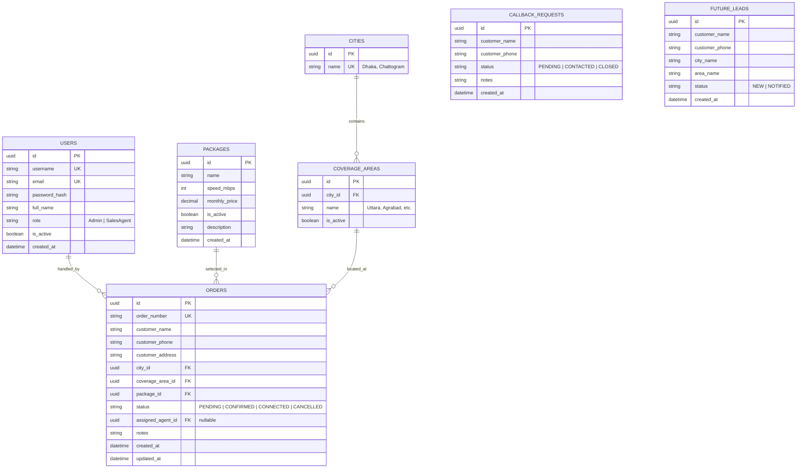
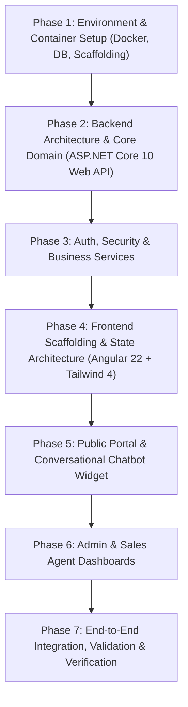

# Implementation Plan: ISP Sales Management System with Customer Chatbot

A modern, robust web application for Internet Service Providers (ISPs) allowing customers to explore packages, verify coverage, and place connection or callback requests via an interactive conversational chatbot, while providing administrative governance and sales order fulfillment workflows.

---

## 1. System Architecture & Tech Stack Analysis

### Backend: ASP.NET Core 10.0 (.NET 10 Web API)
- **Framework & Runtime**: ASP.NET Core 10 (`mcr.microsoft.com/dotnet/sdk:10.0-alpine`)
- **Architecture**: Clean Architecture / Layered structure:
  - `IspSales.Domain`: Entities, Enums (`OrderStatus`, `UserRole`, `LeadStatus`), Value Objects.
  - `IspSales.Application`: DTOs, Service Interfaces, Business Logic, FluentValidation, Mapping.
  - `IspSales.Infrastructure`: EF Core DbContext, PostgreSQL Provider (`Npgsql.EntityFrameworkCore.PostgreSQL`), Migrations, Seed Data, Identity/JWT Token Service, Password Hashing (`BCrypt.Net-Next` or ASP.NET Identity PasswordHasher).
  - `IspSales.Api`: Controllers, Middleware (Global Exception Handler, JWT Authentication, Role-based Authorization), Swagger/OpenAPI specifications.
- **Security**: JWT Bearer token authentication, Claim-based role authorization (`Admin`, `SalesAgent`).

### Database: PostgreSQL 19
- **Image**: `postgres:19rc1-alpine3.24`
- Managed via `docker-compose.yml` for local containerized development and persistent volume mapping.
- Relational design with foreign keys, indexes on search/filter columns (e.g., city, area, order status, date created).

### Frontend: Angular 22 + Tailwind CSS 4
- **Runtime**: Node.js `26.13.0-trixie`
- **Architecture**:
  - Modern Standalone Components (`imports: [...]`), Signals for reactive state management, typed forms, Http Interceptors (JWT attachment and error toast notifications).
  - Clean modular folder structure:
    - `core/`: Auth services, guards (`admin.guard`, `agent.guard`), interceptors, models.
    - `shared/`: Reusable UI components (buttons, badges, modal dialogs, search inputs, data table).
    - `features/public/`: Landing page, package showcase, floating interactive Chatbot widget.
    - `features/admin/`: Admin layout, dashboard metrics, CRUD views for packages, coverage areas, agents, all orders, callback requests, future leads.
    - `features/agent/`: Sales agent portal, filtered order dispatch board, inline order status transitions.
- **Styling**: Tailwind CSS 4 with custom ISP branding palette, responsive mobile-first design, fluid transitions.

### DevOps & Containerization: Docker
- `docker-compose.yml` orchestrating:
  - `db`: PostgreSQL 19 with initial healthcheck and named volume.
  - `backend`: Multi-stage Dockerfile using `.NET 10 Alpine SDK & ASP.NET Alpine Runtime`.
  - `frontend`: Multi-stage Dockerfile (Node build -> Nginx Alpine serving Angular static bundle).

---

## 2. Database Schema Design

---

## 3. API Endpoints Specification

### Authentication & Account
- `POST /api/auth/login` - Authenticate Admin or Sales Agent, returns JWT token and role profile.
- `GET /api/auth/me` - Retrieve current authenticated user profile.

### Public & Customer Endpoints
- `GET /api/public/packages` - Fetch list of active internet packages.
- `GET /api/public/coverage-areas` - Fetch active coverage areas grouped by city (Dhaka, Chattogram, etc.).
- `POST /api/public/chatbot/order` - Submit new connection request (Status: `PENDING`).
- `POST /api/public/chatbot/callback` - Submit quick callback request ("Talk to an Agent").
- `POST /api/public/chatbot/lead` - Record unserved customer location as a "Future Lead".

### Admin Management Endpoints (`[Authorize(Roles = "Admin")]`)
- `GET /api/admin/dashboard/stats` - Summary KPI metrics: Total Orders, Pending Orders, Completed Connections, Total Sales Agents.
- `CRUD /api/admin/packages` - Full management (Create, Read, Update, Delete/Toggle) of packages.
- `CRUD /api/admin/coverage-areas` - Add, Edit, Delete cities and sub-areas.
- `CRUD /api/admin/agents` - Create agent accounts, reset passwords, activate/deactivate agents.
- `GET /api/admin/orders` - Filterable paginated order list (by status, city, date, agent).
- `GET /api/admin/callbacks` - View and manage callback requests.
- `GET /api/admin/leads` - View future expansion leads.

### Sales Agent Endpoints (`[Authorize(Roles = "SalesAgent,Admin")]`)
- `GET /api/agent/orders` - View list of customer orders with details (name, phone, address, package, area).
- `PATCH /api/agent/orders/{id}/status` - Transition status: `PENDING` -> `CONFIRMED` -> `CONNECTED` / `CANCELLED`.
- `POST /api/agent/orders/{id}/notes` - Add internal coordination notes.

---

## 4. Frontend & UX/UI Architecture for Best User Experience

### A. Customer Experience (Modern, Trust-Building & Conversational)
1. **Public Landing Page**:
   - High-impact hero section with value propositions (blazing speed, 99.9% uptime, 24/7 support).
   - Dynamic package cards with clear Mbps indicators, pricing badges, and a direct "Order Now" action that activates the chatbot with pre-selected package context.
   - Interactive Coverage Checker widget: quick instant dropdown to verify if service is available in their sector.
2. **Interactive Customer Chatbot**:
   - Floating widget at bottom-right corner with subtle pulse animation and greeting badge.
   - Guided conversational flow with interactive quick-reply option pills:
     - **Option 1: View Packages** - Renders interactive package carousel/cards directly inside the chat window.
     - **Option 2: New Connection** - Step-by-step interactive breadcrumb (City dropdown -> Area dropdown -> If unlisted, smoothly pivots to "Save Future Lead" -> Package selector -> Contact form -> Instant Order Reference confirmation).
     - **Option 3: Talk to an Agent** - Minimal prompt for Name + Phone, submits callback with instant confirmation message.

### B. Admin & Sales Agent UX (Productive, Clear & Real-Time)
1. **Unified Design System**:
   - Clean Tailwind UI dashboard layout with a collapsible sidebar, breadcrumbs, search bars, and theme-matched status tags.
   - Distinct role badges (`Admin` in Indigo/Violet, `Agent` in Emerald/Teal).
2. **Admin Experience**:
   - Visual KPI metric cards with trend indicators.
   - Intuitive modal dialogs for package pricing and area definitions.
   - Easy management of Future Leads grouped by potential expansion clusters.
3. **Sales Agent Experience**:
   - Streamlined, high-visibility operational table / Kanban view.
   - One-click status badge dropdown to transition orders between `PENDING`, `CONFIRMED`, `CONNECTED`, and `CANCELLED`.
   - Direct click-to-call / phone link for quick communication with leads.

---

## 5. Phased Implementation Roadmap

- **Phase 1**: Scaffold `.NET 10` solution and Angular application; configure `docker-compose.yml` with PostgreSQL 19 and development environment.
- **Phase 2**: Implement domain models, EF Core migrations, and initial seed data (Admin user, standard packages, initial Dhaka & Chattogram coverage areas).
- **Phase 3**: Implement JWT auth, role authorization, repository/service layers, and controllers with FluentValidation.
- **Phase 4**: Setup Angular 22 with Tailwind CSS 4, configure HTTP interceptors, routing, and auth guards.
- **Phase 5**: Build public landing page, interactive packages section, and the multi-step conversational chatbot.
- **Phase 6**: Build Admin dashboard (KPIs, packages, coverage, agents, leads) and Sales Agent order processing view.
- **Phase 7**: Comprehensive verification across all chatbot flows, status transitions, role permissions, and Docker container startup.

---

## User Review Required

> [!IMPORTANT]
> **Key Decisions & Assumptions**:
> 1. Initial seed data will automatically include Dhaka (Uttara, Ashulia, Savar, Mohammadpur) and Chattogram (Colonelhat, Agrabad, Boropol) along with a default Admin account (`admin@ispsales.local` / temporary secure password) for initial login.
> 2. The Chatbot will be an interactive, guided rule-based conversational UI (quick reply chips + form inputs within the chat stream) ensuring 100% deterministic, instant data capture without external paid AI API dependencies.
> 3. Sales agents will have a single shared login portal `/login`, automatically routing based on user role claim to `/admin` or `/agent`.

## Verification Plan
1. **Automated Verification**:
   - `dotnet test` or build check: verifying all models, DTOs, controllers compile without error.
   - `ng build`: verifying Angular 22 builds without template or TypeScript errors.
   - `docker compose config`: verifying containers configure cleanly.
2. **Manual & Flow Verification**:
   - Test Chatbot Option 1 (View Packages), Option 2 (New Connection Order creation & Out-of-coverage Future Lead creation), and Option 3 (Callback Request).
   - Verify Admin login, KPI statistics, Agent account creation, and Coverage/Package CRUD operations.
   - Verify Sales Agent login and order status updating (`PENDING` -> `CONFIRMED` -> `CONNECTED`).
